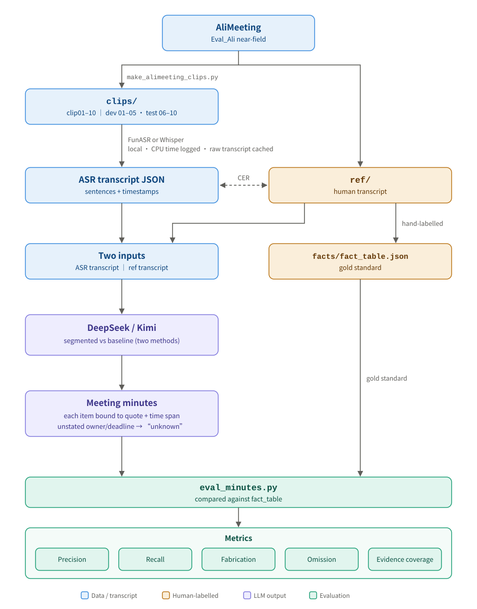

# EchoTrace

Meeting notes from recordings, with timestamped evidence.

English · [中文](README_zh.md)



## Requirements

Python 3.11+, [uv](https://docs.astral.sh/uv/), and ffmpeg.

```bash
uv sync
```

The FunASR models (~2.8 GB) download automatically from ModelScope to `.cache/modelscope/` on the first transcription, and are loaded fully offline afterwards.

## Usage

**1. Prepare the public reference set** (optional)

Download `Eval_Ali.tar.gz` from [AliMeeting](https://www.openslr.org/119/), unpack the near-field data, then run:

```bash
uv run python scripts/make_alimeeting_clips.py --src ~/Eval_Ali/Eval_Ali_near
```

Output goes to `data/public/alimeeting/`: `clips/` audio, `ref/` human transcripts, and `manifest.csv` with the source of each clip.

`facts/` holds the group's hand-built fact table (decisions, action items and open questions, each with its quote and time span), built from `ref/` and used as the gold standard for evaluating minutes. The labelling rules are in the `rules` field of `fact_table.json`; `review_queue.md` lists entries that still need listening.

**2. Transcribe and compute CER**

```bash
uv run python scripts/eval_cer.py
```

Results are written to `results/alimeeting_cer.csv`. Transcripts are cached in `data/cache/asr/`.

ASR comparison (Paraformer vs [faster-whisper-small](https://huggingface.co/Systran/faster-whisper-small): CER, CPU time, evidence coverage):

```bash
uv run python scripts/compare_asr.py
```

Whisper weights (~480 MB) are downloaded from ModelScope to `.cache/modelscope/` on first run and hash-checked; transcripts are cached in `data/cache/asr_whisper/`. Results and analysis: `results/asr_compare/README.md`.

**3. Export drafts for manual correction**

```bash
uv run python scripts/export_transcript.py data/private/audio
```

Exports the ASR draft as one sentence per line with its time span (default: `data/private/corrected/`). Correct the text while listening; the edited file becomes the human-corrected transcript. The raw transcript stays untouched in the cache, and existing drafts are skipped rather than overwritten.

**4. Generate minutes**

Text processing uses the DeepSeek API. Put `DEEPSEEK_API_KEY=...` in `.env` at the project root (`.env` is not committed).

```bash
uv run python scripts/run_minutes.py --method segmented --source asr --split dev
```

- `--method segmented`: the transcript is cut into ~90 s chunks with numbered sentences; the model returns sentence ids only, and the program looks up the time spans from those ids. A responsible person or deadline that cannot be found in the quoted sentences is reset to "未知" (unknown) and flagged.
- `--method baseline`: control group; the whole transcript is summarized directly, the model writes its own quotes, and the program searches for them in the transcript afterwards.
- `--source asr|ref`: run the same pipeline on the ASR or the human transcript, to separate ASR errors from LLM errors.
- `--split dev|test|all`: dev is clip01–05, test is clip06–10; tune prompts on dev only.

Output goes to `results/minutes/{method}_{source}/clipNN.{json,md}`. API responses are cached by request in `data/cache/llm/`, so reruns do not call the API again.

**5. Evaluate minutes**

```bash
uv run python scripts/eval_minutes.py segmented_asr segmented_ref baseline_asr baseline_ref --split dev
```

Compares against `facts/fact_table.json`: precision, recall, type agreement, omissions, fabricated owners/deadlines, and whether evidence spans cover the quoted words. Items are aligned by DeepSeek; the alignment is saved in `results/eval/{run}_{split}.json` for manual spot-checks, and the summary table in `results/eval/summary_{split}.md`.

## Layout

```
src/echotrace/asr.py              local transcription + caching
src/echotrace/transcript.py       read/write the correction format
src/echotrace/llm.py              DeepSeek client + cache
src/echotrace/minutes.py          minutes (segmented evidence method / direct-summary baseline)
src/echotrace/evidence.py         locate quotes in a transcript
scripts/make_alimeeting_clips.py  cut clips from AliMeeting
scripts/eval_cer.py               CER evaluation
scripts/export_transcript.py      export drafts for correction
scripts/run_minutes.py            generate minutes
scripts/eval_minutes.py           evaluate minutes
data/public/                      public datasets (audio not committed)
data/public/alimeeting/facts/     hand-built fact table (evaluation gold standard)
data/private/                     private recordings, transcripts, annotations (whole directory not committed)
data/cache/                       ASR and LLM caches (not committed)
results/                          evaluation results
```

## Data and privacy

- Private recordings require prior consent from the participants and are processed locally only — never uploaded or published.
- Audio is transcribed offline on the local machine; only short text snippets are sent to the text API.
- All timestamps come from the transcription or from manual checking, never from an LLM's guess.

The AliMeeting dataset is licensed CC BY-SA 4.0; see [OpenSLR 119](https://www.openslr.org/119/) for citation.
